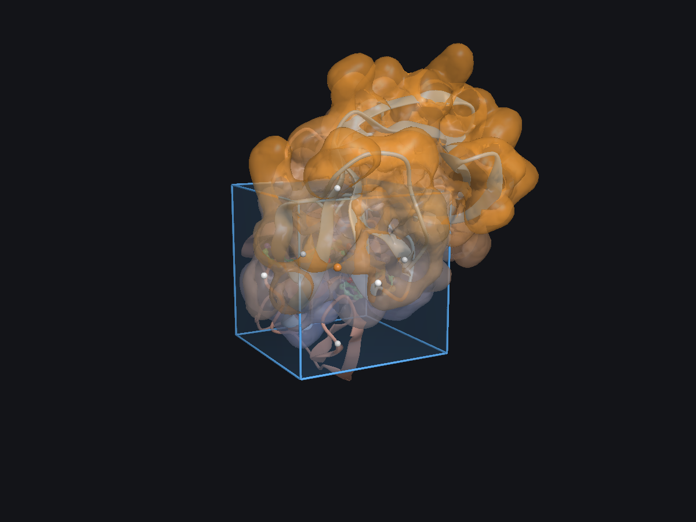

# openmols

An open-source desktop workbench for structure-based drug discovery, written in Rust.
A fast molecular viewer, projects for discovery campaigns, docking and pocket
detection that run in Docker, measurement tools, and an LLM assistant that drives it all.



*The 1HSG protease rendered headlessly by the same renderer the app uses: a translucent
surface coloured by distance to the ligand, a docking box with drag handles, and depth-correct overlays.*

## What it does

- **Viewer.** Cartoon, Gaussian surface, ball & stick, spacefill, licorice and backbone, with
  several structures in one scene, rigid-body posing (`G` / `R`, Blender-style), alignment,
  and ensembles or trajectories played as frames.
- **Projects.** One folder plus a SQLite file per campaign: structures, saved views, notes,
  chats and every job that was run.
- **Docking.** AutoDock Vina and AutoDock4, including **covalent docking** to Cys, Lys, Ser
  and Tyr (Meeko's tethered method); FRODOCK for protein–protein docking if you supply your own copy.
  Results load as frames of one entity, best pose first.
- **Pockets.** pyKVFinder on one structure or across every frame of an ensemble, merged into
  consensus pockets scored by persistence.
- **Measure.** Click-to-measure distances, angles and dihedrals; H-bond / contact / clash
  sets between entities; a docking box you place on an atom and drag to size;
  solvent-accessible surface, volume and pocket overlap; translucent or wireframe volumes
  coloured by exposure. Every object has an eye to show or hide it.
- **Assistant.** Chat with any OpenAI-compatible endpoint (OpenRouter, LM Studio, Ollama,
  vLLM, OpenAI). The model can call the same tools you click: fetch a PDB entry, change
  representations, measure, dock, read results. API keys are kept in the OS keychain.

## Try it in two minutes

1. Install Docker (Docker Desktop on Windows and macOS) and start it.
2. Build and run (below).
3. **Project tab → Load the example.** It sets up HIV protease and its inhibitor indinavir
   (PDB 1HSG) as two entities with a search box.
4. **Jobs tab → Dock (AutoDock)… → Run.** The first run pulls and builds the image once.
   Redocking indinavir with Vina scores about −11.6 kcal/mol and lands within 0.3 Å of the crystal pose.

## Build

You need a recent stable Rust (the repository pins one in `rust-toolchain.toml`) and a GPU
with a Vulkan, Metal or DirectX 12 driver.

```sh
cargo run --release -p app                    # opens the window
cargo run --release -p app -- path/to/project # or a project folder / structure file
cargo test --workspace
```

| Platform | Status |
| --- | --- |
| Windows 11 | developed and used daily |
| Linux | built and tested in CI; not yet used interactively |
| macOS | built and tested in CI; not yet used interactively |

Reports from Linux and macOS users are especially welcome.

**Linux packages** (Debian / Ubuntu names): `build-essential pkg-config cmake clang
libxkbcommon-dev libxkbcommon-x11-dev libwayland-dev libxcb1-dev libx11-xcb-dev
libxcb-xkb-dev libfontconfig1-dev libfreetype6-dev libssl-dev libvulkan-dev libasound2-dev`,
plus a Vulkan driver at run time.

## The assistant

Open **⚙ Settings → LLM**, pick or add a provider, set the base URL, the model and a key
(or the name of an environment variable that holds it). Keys go to the system keychain
(Windows Credential Manager, macOS Keychain, Linux keyutils); `config.json` holds none.
A local model through LM Studio or Ollama needs no key.

## How it is laid out

| Crate | Purpose |
| --- | --- |
| `crates/molecule` | Data model, PDB / mmCIF / SDF parsing, bonds, secondary structure, alignment, geometry (contacts, SASA, volume) |
| `crates/render` | wgpu renderer with impostors, meshes, cartoon, Gaussian surface, translucent volumes, picking and a world-space overlay. No UI toolkit dependency |
| `crates/project` | A project: one folder and a SQLite file |
| `crates/jobs` | Running tools in Docker; command builders and output parsers for pyKVFinder, FRODOCK, AutoDock |
| `crates/llm` | Streaming chat client for OpenAI-compatible endpoints, with tool calls |
| `crates/app` | The GPUI application: viewport, panels, dialogs, chat and the assistant's tools |

External tools never link into openmols. They run as processes in containers built from
`docker/<tool>/Dockerfile`, which keeps their licences at arm's length.

## Project documents

- [ROADMAP.md](ROADMAP.md): what is done and what is next
- [CONTRIBUTING.md](CONTRIBUTING.md): how to build, test, and add a tool
- [docs/LICENSES.md](docs/LICENSES.md): licences of the tools openmols runs and of its dependencies

## Licence

Apache-2.0, see [LICENSE](LICENSE). The tools run in containers keep their own licences;
see [docs/LICENSES.md](docs/LICENSES.md), in particular for FRODOCK, which is not redistributed.
